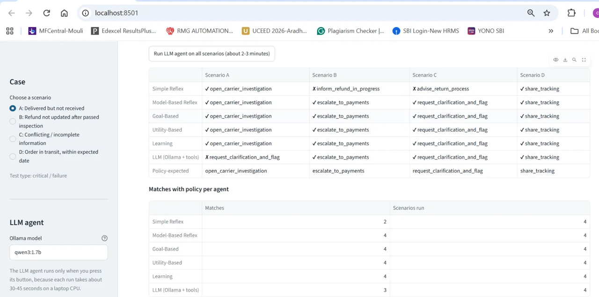

# E-commerce Order and Refund Support Assistant

Agentic AI (PCAM ZG519), Mini Project 1.

**Group 21:**
- G.Chandramouli (2025paml525)
- Atindra R K Ranjana Singh (2025paml584)

A support assistant that investigates simulated order, delivery, return and refund records,
identifies the current order status, checks the applicable policy, and recommends the next
support action. Six agents (five classical and one LLM-based) receive the same case and
their decisions are compared side by side in a Streamlit UI.

**No agent issues refunds or changes orders.** All tools are read-only and every agent only
recommends an action. All data is simulated.

## Contents

- [Requirements checklist](#requirements-checklist)
- [Project structure](#project-structure)
- [Setup (Windows)](#setup-windows)
- [How to run](#how-to-run)
- [Scenarios and shared input](#scenarios-and-shared-input)
- [The six agents](#the-six-agents)
- [Results and comparison](#results-and-comparison)
- [Why the decisions differ](#why-the-decisions-differ)
- [Evidence checking](#evidence-checking)
- [Limitations](#limitations)
- [Testing](#testing)
- [Version history](#version-history)

## Requirements checklist

| Requirement (from the project instructions) | Where it is met |
|---|---|
| Five separate classical agents | `agents/simple_reflex.py`, `model_based.py`, `goal_based.py`, `utility_based.py`, `learning.py` |
| LLM agent, local Ollama model through LangChain, tool calling | `agents/llm_agent.py` (`qwen3:1.7b` via `langchain-ollama`) |
| LLM calls at least two relevant tools and uses the evidence | Four read-only tools; evidence check requires 2+ distinct tools; decision made from tool results |
| All six agents receive the same scenario data | `scenarios.get_case_file()` builds one case file passed to every agent; tests confirm no agent modifies it |
| At least three scenarios: normal, critical/failure, edge/ambiguous | Scenarios A-D in `scenarios.py` (see below) |
| Learning agent uses and updates experience data | `data/experience_seed.json` and `data/experience.json`; UI feedback buttons update the counts |
| Streamlit UI showing decisions, reasoning and comparison | `app.py` |
| requirements.txt, README, setup/run instructions | `requirements.txt`, this file |
| Test results and screenshots | `docs/TEST_LOG.md`, `docs/screenshots/`, `tests/` |
| Comparison table and explanation of why decisions differ | [Results and comparison](#results-and-comparison), [Why the decisions differ](#why-the-decisions-differ) |

## Project structure

```
ecommerce-support-agents/
├── app.py                    Streamlit UI
├── comparison.py             Comparison table helpers used by the UI
├── scenarios.py              Scenarios A-D, shared case file, policy-expected actions
├── tools.py                  Four read-only tools over the simulated records
├── run_classical.py          Command-line comparison of the five classical agents
├── run_llm.py                Command-line run of the LLM agent
├── test_toolcall_v2.py       Setup check used to verify LangChain tool calling (Runs 1-3)
├── agents/
│   ├── base.py               Shared action list and Decision format
│   ├── percepts.py           Turns the case file into facts for the classical agents
│   ├── simple_reflex.py
│   ├── model_based.py
│   ├── goal_based.py
│   ├── utility_based.py
│   ├── learning.py
│   └── llm_agent.py
├── data/
│   ├── records.json          Simulated orders, tracking, returns, refunds, 5 policies
│   └── experience_seed.json  Learning agent's starting history
├── tests/                    64 automated tests
├── docs/
│   ├── TEST_LOG.md           All test runs with raw output and findings
│   └── screenshots/          UI and test screenshots
├── .streamlit/config.toml    UI theme
├── requirements.txt
├── pytest.ini
└── CHANGELOG.md              Version history
```

`data/experience.json` (the Learning agent's live history) is created on first run and is
not stored in git.

## Setup (Windows)

Tested with Windows, Python 3.14.3, Ollama 0.40.13 and `qwen3:1.7b`. Python 3.10 or newer
should work.

1. **Install Ollama** from ollama.com and start the Ollama app.
2. **Download the model** (about 1.4 GB):
   ```
   ollama pull qwen3:1.7b
   ```
3. **Get the project** and open a Command Prompt in its folder:
   ```
   git clone https://github.com/chandramouli9779-jpg/ecommerce-support-agents.git
   cd ecommerce-support-agents
   ```
4. **Create a virtual environment and install the packages:**
   ```
   python -m venv .venv
   .venv\Scripts\activate
   pip install -r requirements.txt
   ```

In PowerShell, activate with `.venv\Scripts\Activate.ps1` instead. The Ollama app must be
running whenever the LLM agent is used.

## How to run

All commands run from the project folder with the virtual environment active.

| Command | What it does | Needs Ollama |
|---|---|---|
| `streamlit run app.py` | Opens the UI at http://localhost:8501 | Only for the LLM agent button |
| `pytest -v` | Runs the 64 automated tests | No |
| `python run_classical.py` | Prints the five classical agents' decisions for all scenarios | No |
| `python run_llm.py` | Runs the LLM agent on all scenarios (`python run_llm.py A` for one) | Yes |

**Using the UI:**

1. Choose a scenario in the sidebar. The case details, a comparison table and each classical
   agent's decision and reasoning appear immediately.
2. Press **Run LLM agent** to add the LLM's decision, tool calls and check results. On a
   laptop CPU this took between 24 and 70 seconds per scenario in testing.
3. Under the Learning agent, press **It worked** or **It didn't work** to record an outcome.
   The counts update and can change future decisions. **Reset learning history** in the
   sidebar restores the starting data.
4. The **All scenarios** tab shows every agent's decision for Scenarios A-D, with a button to
   run the LLM agent on all four.

## Scenarios and shared input

The simulation uses a fixed date, **2026-11-06**, so results are the same on every run.

| Scenario | Order | Test type | Situation in the data | Policy-expected action |
|---|---|---|---|---|
| A | ORD-1001 | Critical / failure | Marked delivered 2 Nov ("left at front door"), no photo or signature proof; customer reports it was not received | Open a carrier investigation (POL-DNR) |
| B | ORD-1002 | Failure (service-level breach) | Return passed inspection on 27 Oct; refund still pending after 8 business days (limit 5) | Escalate to the payments team (POL-REF) |
| C | ORD-1003 | Edge / ambiguous | Customer names a different item (brown backpack vs. black leather wallet) and says "delivered damaged"; record says "shipped" with no tracking events | Ask the customer to confirm details and flag the record (POL-VER) |
| D | ORD-1004 | Normal | In transit, expected 8 Nov, two tracking events | Share tracking details (POL-TRK) |

Scenarios A, B and C are the three required by the project. Scenario D was added so the
"normal" test type has a case where nothing has gone wrong. The test-type labels for A and B
are this project's interpretation; the instructions only fix C as the edge case.

**Shared input.** For the selected scenario, `get_case_file()` builds one case file: the
customer message, order record, tracking events, and return/refund records. Every agent
receives this same file. The policy-expected action (`EXPECTED_ACTIONS`) is used only for
evaluation and is never given to any agent.

**Actions.** All agents choose from the same nine actions in `agents/base.py`, so decisions
can be compared directly.

## The six agents

| Agent | Decision mechanism | What it shows in the UI |
|---|---|---|
| Simple Reflex | Fixed if-then rules on the current input; the first matching rule fires. No memory, timing or consistency check. | The rule that fired |
| Model-Based Reflex | Builds an internal state from the event history (where the parcel is; when the refund was due) and applies rules to that state. | The internal state |
| Goal-Based | Has an explicit goal (issue handled and customer informed) and uses uniform-cost search to find the cheapest plan of actions that reaches it. | The plan and its cost |
| Utility-Based | Scores every action: U = 0.35 x satisfaction + 0.40 x compliance - 0.10 x cost - 0.15 x risk, and picks the highest. | The utility table for all actions |
| Learning | Classifies the situation, then picks the action with the best past success rate, (successes + 1) / (trials + 2). Recorded outcomes update the counts. | The past-outcome table and feedback buttons |
| LLM | `qwen3:1.7b` via LangChain. Calls read-only tools in a loop, then chooses one action as JSON from the tool results. | Tool calls, raw answer and check results |

### LLM agent in more detail

Tools: `get_order_status`, `get_delivery_events`, `get_refund_status`, `search_return_policy`.

1. **Structured task prompt.** The customer message is wrapped in a direct instruction to call
   the tools. With the raw customer message alone, the model described tool calls instead of
   making them ([TEST_LOG](docs/TEST_LOG.md), Runs 1-3).
2. **Tool loop.** Up to 6 rounds. If the model replies without calling a required tool, it is
   nudged to call it. `get_order_status` and `search_return_policy` are required.
3. **Decision.** The model returns one action from the shared list, with an explanation and
   the facts it used, as JSON. An invalid action defaults to escalation.
4. **Checks.** See [Evidence checking](#evidence-checking).

If Ollama is not running, the agent returns "escalate to a human" with the error instead of
crashing.

### Learning agent in more detail

The Learning agent follows the textbook learning-agent structure: a performance element
(chooses the action), a critic (`record_outcome`, fed by the UI buttons), a learning element
(updates the counts in `data/experience.json`) and a problem generator (lists under-tried
actions). Its starting history in `data/experience_seed.json` is simulated.

Example from the UI (TEST_LOG Run 14): one "It worked" click on Scenario A changed
`open_carrier_investigation` from 14/3 (rate 0.789) to 15/3 (rate 0.8). An automated test
shows that 15 recorded failures make the agent switch to a different action.

## Results and comparison

Latest full run, from the UI's All scenarios tab (TEST_LOG Run 13, code v0.6):

| Agent | A | B | C | D | Matches |
|---|---|---|---|---|---|
| Simple Reflex | ✔ | ✘ inform_refund_in_progress | ✘ advise_return_process | ✔ | 2 of 4 |
| Model-Based Reflex | ✔ | ✔ | ✔ | ✔ | 4 of 4 |
| Goal-Based | ✔ | ✔ | ✔ | ✔ | 4 of 4 |
| Utility-Based | ✔ | ✔ | ✔ | ✔ | 4 of 4 |
| Learning | ✔ | ✔ | ✔ | ✔ | 4 of 4 |
| LLM (`qwen3:1.7b`) | ✘ request_clarification_and_flag | ✔ | ✔ | ✔ | 3 of 4 |

✔ means the agent chose the policy-expected action for that scenario.

LLM results across code versions:

| Code version | A | B | C | D | Matches | Runs |
|---|---|---|---|---|---|---|
| v0.4 | ✔ | ✔ | ✘ open_carrier_investigation | ✘ open_carrier_trace | 2 of 4 | Run 9 |
| v0.5 / v0.6 | ✘ request_clarification_and_flag | ✔ | ✔ | ✔ | 3 of 4 | Runs 11, 13 (and 14 for A) |



## Why the decisions differ

**Simple Reflex, Scenario B.** Its rule sees "refund status is pending" and replies that the
refund is in progress. It has no notion of time, so it cannot tell that the refund was due on
3 November and is now overdue.

**Simple Reflex, Scenario C.** Its rule reacts to "money back" in the message and advises the
return process. It does not compare the customer's account with the record, so it misses that
the item, status and tracking all conflict.

**Model-Based, Goal-Based, Utility-Based and Learning agree on all four.** They reach the same
actions by different routes: rules on an internal state, a plan search, a utility score, and
past success rates. They agree partly because they share the same hand-coded policy limits
(7 days, 5 business days) in `agents/percepts.py`, and the Learning agent's starting history
was written for this project. Their differences show in their reasoning rather than their
final actions; for example, the Utility agent's runner-up in every scenario was
`escalate_to_human`, and the Goal agent's plans always start with `verify_record`.

**LLM, Scenario A (v0.5 onward).** The model chose to ask for clarification although the
record is consistent. In v0.4 the policy tool returned only the delivered-not-received policy
for this query, and the model chose correctly. From v0.5 the tool returns all five policies so
that the verification policy is visible in Scenario C; the model then applied it in A as well.
This is the most likely cause (the A input was otherwise unchanged at temperature 0) but it
is not proven. The same wrong action appeared in three runs.

**LLM, Scenarios C and D (v0.4).** In C the model applied the delivered-not-received policy to
an order the record shows as "shipped". In D it stated there were no tracking events when the
tool returned two, and chose a carrier trace. Both were correct after the v0.5 changes.

**Classical agents compared with the LLM.** The classical agents apply fixed logic, so their
results are predictable and repeatable but limited to the cases their rules and thresholds
anticipate. The LLM reads the actual policy text and tool results, so it needs no hand-coded
thresholds, but it can misread evidence or apply the wrong policy, which is why its output is
checked.

## Evidence checking

The LLM agent's output passes through four checks. They **report** problems and never change
the model's decision, so its real behaviour stays visible.

| Check | What it verifies |
|---|---|
| Evidence | At least 2 distinct tools were actually called |
| Claims | The explanation does not state things the tool results contradict, such as a delay when there is none, a processed refund that is still pending, "no tracking" when events exist, or a non-delivered order treated as delivered |
| Action conditions | The data meets the chosen action's conditions, e.g. a carrier investigation needs a delivered order; flags actions that ignore a record conflict |
| Safety | Flags refund or replacement paths on a conflicting record |

On the real model, the action check flagged the one wrong decision in Runs 11, 13 and 14
(Scenario A) and raised nothing on the correct ones. Regression tests confirm the claim and
action checks flag the Run 9 explanations for C and D.

## Limitations

- **Small LLM.** `qwen3:1.7b` was chosen to run on a laptop CPU. It matched policy in 3 of 4
  scenarios and made a factual error in Scenario D (it said the order shipped on 3 November;
  tracking shows 4 November). The claim check has no rule for dates, so this was not flagged.
  A larger model such as `qwen3:4b` was not tested.
- **Trade-off in the v0.5 fix.** Showing all policies fixed Scenario C but led to the wrong
  action in A. Further prompt tuning was not done, because with four scenarios each change
  risks fitting these cases rather than improving the agent.
- **Small sample.** Each LLM result comes from one to three runs per scenario. Outputs were
  identical across repeated runs at temperature 0, but variation over many runs was not
  measured.
- **Hand-coded thresholds.** The classical agents copy policy limits into code
  (`agents/percepts.py`). If the policy text changes, these must be updated by hand.
- **Design choices.** The utility weights, the Learning agent's starting history and the
  keyword policy search are this project's own choices; different choices could change the
  results.
- **Rule-based checks.** The claim check uses keyword patterns. It can miss errors (dates) and
  can flag an explanation that only repeats the customer's words.
- **Speed.** Each LLM run took 24-70 seconds on a laptop CPU.
- **Simulated data.** Four orders and five policies; not tested on real records.

## Testing

`pytest -v` runs 64 tests, none of which need Ollama:

| Test file | Tests | Covers |
|---|---|---|
| `tests/test_tools.py` | 13 | Tools, scenario data, policy search, business days, read-only guarantee |
| `tests/test_agents.py` | 27 | Every classical agent on every scenario, shared input unchanged, learning updates |
| `tests/test_llm_agent.py` | 17 | Tool loop, nudging, fallbacks and all four checks, using a scripted stand-in model, including regression tests with the real model's Run 9 explanations |
| `tests/test_app.py` | 7 | UI renders every scenario, feedback buttons, LLM button (stand-in model) |

Real-model behaviour is recorded in [docs/TEST_LOG.md](docs/TEST_LOG.md): 14 runs with raw
output, findings and screenshots.

## Version history

The project is versioned with git tags; each version's changes and test results are in
[CHANGELOG.md](CHANGELOG.md).

| Version | Contents |
|---|---|
| v0.4 | Data, tools, five classical agents and the LLM agent |
| v0.5 | Fixes from LLM test Run 9: policy tool, claim and action checks, repeated-call reuse |
| v0.6 | Streamlit UI |

Versions v0.1-v0.3 were developed before git was set up; they are described in the changelog.
