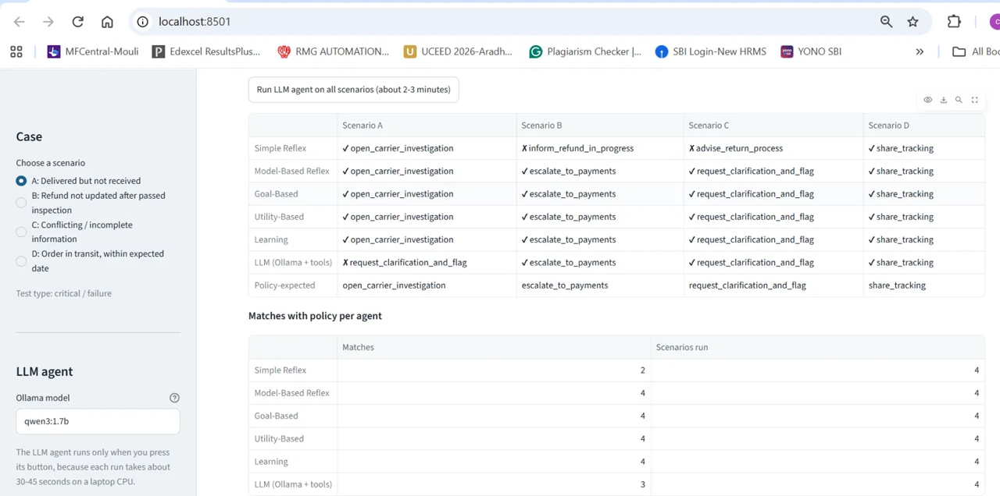
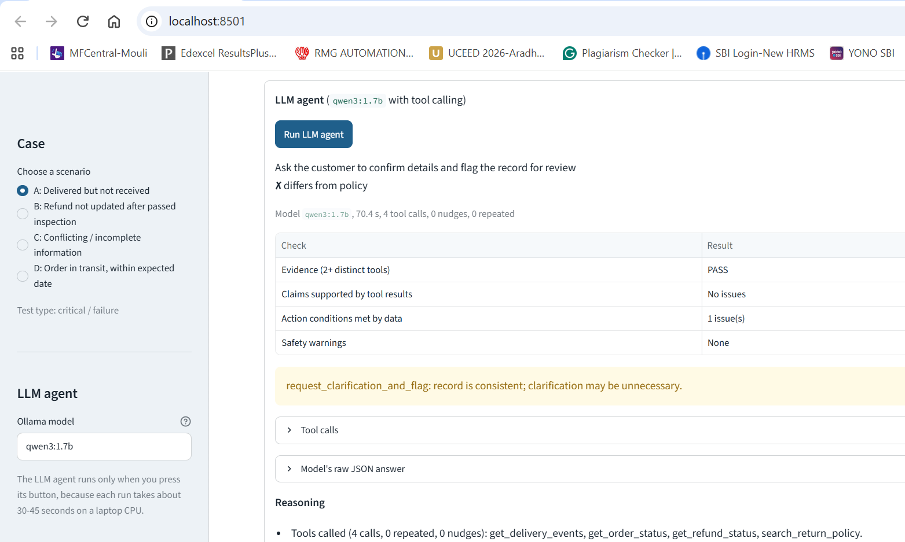
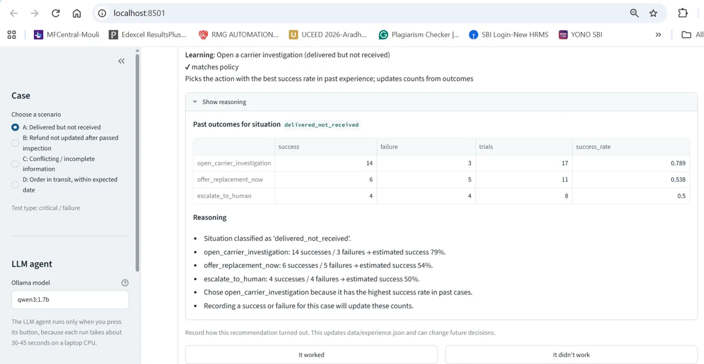
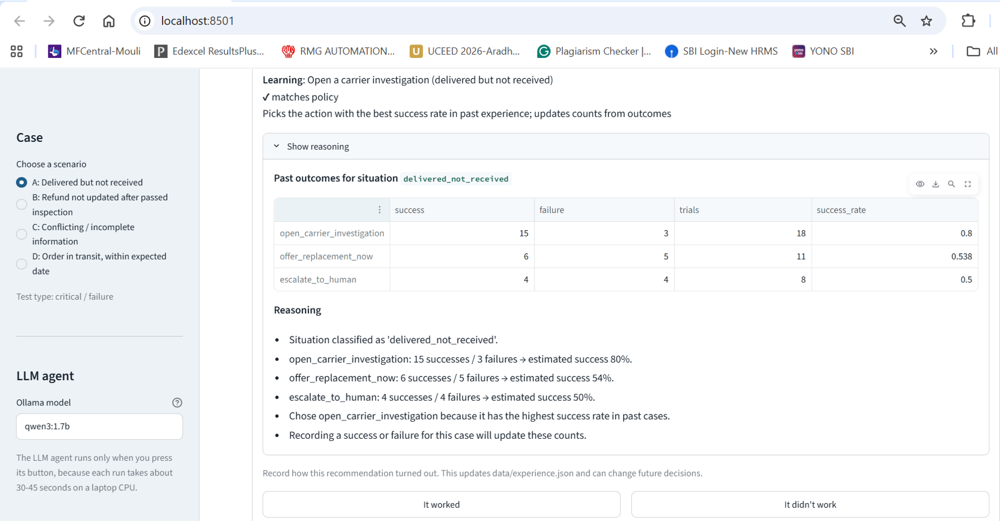

# Test Run Log - E-commerce Order and Refund Support Assistant

Agentic AI (PCAM ZG519) - Mini Project 1

This log records test runs executed on the student's laptop. Raw outputs are copied
exactly as printed in the terminal. Each entry states the code version it was run on
(see `CHANGELOG.md`).

## Test environment

| Item | Value |
|---|---|
| Operating system | Windows (build 10.0.26300.9711) |
| Python | 3.14.3 (virtual environment `.venv`) |
| Ollama | 0.40.13 |
| LLM | `qwen3:1.7b` (local, via Ollama) |
| LangChain | langchain 1.4.9, langchain-ollama 1.1.0, langchain-core 1.7.6 |
| Test framework | pytest 9.2.0 |
| Simulation reference date | 2026-11-06 (fixed in `data/records.json`) |

## Summary of runs

| # | Date | Version | Command | Result |
|---|---|---|---|---|
| 1 | 2026-11-06 | v0.1 | `python diag.py` | Tool calling works through LangChain (single tool, short question) |
| 2 | 2026-11-06 | v0.1 | `python diag2.py` | Long conversational prompt prevents tool calls; short direct prompt works |
| 3 | 2026-11-06 | v0.1 | `python test_toolcall_v2.py` | 2 tools called, 0 nudges, evidence check PASS |
| 4 | 2026-11-06 | v0.2 | `pytest -v` | 13 passed |
| 5 | 2026-11-06 | v0.3 | `python run_classical.py` | 18 of 20 decisions match policy; Simple Reflex differs in B and C |
| 6 | 2026-11-06 | v0.3 | `pytest -v` | 40 passed |
| 7 | 2026-11-08 | v0.4 | `pytest -v` | 52 passed |
| 8 | 2026-11-08 | v0.4 | `python run_llm.py A` | Correct action, 45.1 s |
| 9 | 2026-11-08 | v0.4 | `python run_llm.py` | 2 of 4 match policy (A, B correct; C, D differ) |
| 10 | 2026-11-08 | v0.5 | `pytest -v` | 57 passed |
| 11 | 2026-11-08 | v0.5 | `python run_llm.py` | 3 of 4 match policy (B, C, D correct; A differs) |
| 12 | 2026-11-08 | v0.6 | `pytest -v` | 64 passed |
| 13 | 2026-11-08 | v0.6 | Streamlit UI, "Run LLM agent on all scenarios" | LLM 3 of 4 (same as Run 11); classical agents unchanged |
| 14 | 2026-11-08 | v0.6 | Streamlit UI, single-scenario LLM run and Learning feedback | LLM same action in A as Runs 11 and 13 (70.4 s); feedback button updates the Learning table |

---

## Run 1-3: Setup verification (v0.1)

### Problem observed
The first tool-calling script (`test_toolcall.py`) returned no tool calls and an empty
answer on two attempts.

### Run 1 - `diag.py` (isolating the cause)

| Test | Reply text | Tool calls |
|---|---|---|
| 1. Plain chat, thinking on | `Hello` | none |
| 2. Plain chat, thinking off | `Halo.` | none |
| 3. One tool, thinking on | (empty) | `get_order_status(ORD-1001)` |
| 4. One tool, thinking off | (empty) | `get_order_status(ORD-1001)` |

Finding: Ollama, LangChain and tool calling all work; `reasoning=False` is not the cause.

### Run 2 - `diag2.py` (which prompt difference stops tool calls)

| Variant | Setup | Tool called |
|---|---|---|
| A | System message + long conversational question + 2 tools | 0 of 2 attempts |
| B | No system message + long question + 2 tools | 1 of 2 |
| C | System message + long question + 1 tool | 0 of 2 |
| D | System message + short direct question + 2 tools | 2 of 2 |

Finding: with the long conversational message, the model wrote "Let me look that up for
you" without making the call. Question wording was the main factor; number of tools was
not (C failed with 1 tool). At temperature 0, repeated attempts gave identical results.
Limitation: 2 attempts per variant only.

### Run 3 - `test_toolcall_v2.py` (structured task prompt + loop + nudge)

```
Round 1: get_order_status({'order_id': 'ORD-1001'}) -> {'status': 'delivered', 'delivered_on': '2026-11-02'}
Round 1: get_delivery_events({'order_id': 'ORD-1001'}) -> ['2026-10-30 shipped', '2026-11-01 out for delivery', '2026-11-02 delivered - left at front door']

Distinct tools used: ['get_delivery_events', 'get_order_status'] | nudges needed: 0
Evidence check: PASS
```

Observation: the final answer said the problem "could be due to a delivery delay", which
the tracking data does not support (delivery was on schedule). This motivated the claim
check added in v0.4.

---

## Run 4: Data and tools tests (v0.2)

`pytest -v` - **13 passed in 0.04s** (after adding the langsmith warning filter to `pytest.ini`;
the first run showed 13 passed with 13 DeprecationWarnings from the `langsmith` package,
not from project code).

---

## Run 5: Classical agents comparison (v0.3)

Command: `python run_classical.py`

| Scenario | Policy-expected | Simple Reflex | Model-Based | Goal-Based | Utility-Based | Learning |
|---|---|---|---|---|---|---|
| A | open_carrier_investigation | ✔ | ✔ | ✔ | ✔ | ✔ |
| B | escalate_to_payments | ✘ inform_refund_in_progress | ✔ | ✔ | ✔ | ✔ |
| C | request_clarification_and_flag | ✘ advise_return_process | ✔ | ✔ | ✔ | ✔ |
| D | share_tracking | ✔ | ✔ | ✔ | ✔ | ✔ |

Raw output:

```
=== Scenario A: Delivered but not received (critical / failure)
    Policy-expected action: open_carrier_investigation  [POL-DNR: reported within 7 days, no photo/signature proof]
  [OK ] Simple Reflex       -> open_carrier_investigation
         Rule fired: Customer says not received and status is delivered
  [OK ] Model-Based Reflex  -> open_carrier_investigation
         History says delivered (delivered - left at front door) but the customer says not received; reported in time and no proof of delivery.
  [OK ] Goal-Based          -> open_carrier_investigation
         Plan: verify_record -> open_carrier_investigation -> notify_customer
  [OK ] Utility-Based       -> open_carrier_investigation
         Best: open_carrier_investigation (U=0.565); runner-up: escalate_to_human (U=0.34).
  [OK ] Learning            -> open_carrier_investigation
         delivered_not_received: open_carrier_investigation succeeded 14/17 times (est. 79%)

=== Scenario B: Refund not updated after passed inspection (failure (service-level breach))
    Policy-expected action: escalate_to_payments  [POL-REF: refund pending 8 business days after inspection (limit 5)]
  [DIFF] Simple Reflex       -> inform_refund_in_progress
         Rule fired: Refund status is pending
  [OK ] Model-Based Reflex  -> escalate_to_payments
         Refund was due by 2026-11-03 but is still pending.
  [OK ] Goal-Based          -> escalate_to_payments
         Plan: verify_record -> escalate_to_payments -> notify_customer
  [OK ] Utility-Based       -> escalate_to_payments
         Best: escalate_to_payments (U=0.635); runner-up: escalate_to_human (U=0.34).
  [OK ] Learning            -> escalate_to_payments
         refund_overdue: escalate_to_payments succeeded 11/12 times (est. 86%)

=== Scenario C: Conflicting / incomplete information (edge / ambiguous)
    Policy-expected action: request_clarification_and_flag  [POL-VER: item and status conflict with record; tracking missing]
  [DIFF] Simple Reflex       -> advise_return_process
         Rule fired: Customer asks for a refund / money back
  [OK ] Model-Based Reflex  -> request_clarification_and_flag
         State shows the record does not match the customer's account or the tracking history is missing.
  [OK ] Goal-Based          -> request_clarification_and_flag
         Plan: verify_record -> request_clarification_and_flag
  [OK ] Utility-Based       -> request_clarification_and_flag
         Best: request_clarification_and_flag (U=0.5225); runner-up: escalate_to_human (U=0.34).
  [OK ] Learning            -> request_clarification_and_flag
         record_conflict: request_clarification_and_flag succeeded 9/11 times (est. 77%)

=== Scenario D: Order in transit, within expected date (normal)
    Policy-expected action: share_tracking  [POL-TRK: in transit and within expected delivery date]
  [OK ] Simple Reflex       -> share_tracking
         Rule fired: Order status is in transit
  [OK ] Model-Based Reflex  -> share_tracking
         History shows the parcel is moving and tracking is up to date.
  [OK ] Goal-Based          -> share_tracking
         Plan: verify_record -> share_tracking
  [OK ] Utility-Based       -> share_tracking
         Best: share_tracking (U=0.59); runner-up: escalate_to_human (U=0.34).
  [OK ] Learning            -> share_tracking
         in_transit: share_tracking succeeded 20/22 times (est. 88%)
```

---

## Run 6: Unit tests with classical agents (v0.3)

`pytest -v` - **40 passed in 0.16s** (27 in `tests/test_agents.py`, 13 in `tests/test_tools.py`).

---

## Run 7: Unit tests with LLM agent (v0.4)

`pytest -v` - **52 passed in 0.57s**

| Test file | Tests | Result |
|---|---|---|
| `tests/test_agents.py` | 27 | all passed |
| `tests/test_llm_agent.py` | 12 | all passed |
| `tests/test_tools.py` | 13 | all passed |

Note: `tests/test_llm_agent.py` uses a scripted stand-in model, so it verifies the agent's
loop, nudging, fallbacks and checks without Ollama. Real model behaviour is in Runs 8-9.

---

## Run 8: LLM agent, Scenario A only (v0.4)

```
=== Scenario A: Delivered but not received
  Policy-expected: open_carrier_investigation
  [OK ] LLM -> open_carrier_investigation   (45.1 s)
    round 1: get_order_status({'order_id': 'ORD-1001'})
    round 1: get_delivery_events({'order_id': 'ORD-1001'})
    round 1: get_refund_status({'order_id': 'ORD-1001'})
    round 1: search_return_policy({'query': 'My order ORD-1001 shows as delivered on 2 November, but I never received the package. Nothing was at my door.'})
    round 2: search_return_policy({'query': 'My order ORD-1001 shows as delivered on 2 November, but I never received the package. Nothing was at my door.'})
  - Tools called (5 calls, 0 nudges): get_delivery_events, get_order_status, get_refund_status, search_return_policy.
  - Evidence check: PASS (4 distinct tools, minimum 2).
  - Model explanation: The customer reported their order as delivered but did not receive the package. The 'Delivered but not received' policy indicates a carrier investigation is needed. The tool result shows the case is eligible for a replacement or refund once the investigation has run for 3 business days without the package being located.
  - Claim check: no unsupported claims found.
```

---

## Run 9: LLM agent, all scenarios (v0.4)

| Scenario | Policy-expected | LLM chose | Match | Tool calls | Nudges | Time |
|---|---|---|---|---|---|---|
| A | open_carrier_investigation | open_carrier_investigation | ✔ | 5 (4 distinct) | 0 | 32.2 s |
| B | escalate_to_payments | escalate_to_payments | ✔ | 4 (4 distinct) | 0 | 31.1 s |
| C | request_clarification_and_flag | open_carrier_investigation | ✘ | 5 (4 distinct) | 0 | 36.8 s |
| D | share_tracking | open_carrier_trace | ✘ | 4 (4 distinct) | 0 | 24.2 s |

### Findings

1. **Tool calling was reliable:** all 4 tools called in round 1 in every scenario; no nudges; evidence check PASS in all 4.
2. **Scenario C (wrong action):** the model applied the "delivered but not received" policy although the record status is "shipped", the customer reported damage (not non-receipt), and the item named differs from the record. Contributing cause in the project's own tool: `search_return_policy` uses keyword matching; the query contained "delivered" but no verification-policy keyword, so only POL-DNR was returned and POL-VER was never shown to the model.
3. **Scenario D (false statement):** the model said the order had "no tracking events", but `get_delivery_events` returned 2 events (2026-11-04 shipped, 2026-11-05 arrived at regional hub). It chose a carrier trace based on that false statement.
4. **Gaps in the project's checks:** the claim check reported "no unsupported claims" in C and D. It had no rule for false "no tracking" statements or for treating a non-delivered order as delivered. The safety check only covered refund-type actions.
5. **Repeated tool call:** `search_return_policy` was called twice with an identical query in A and C.
6. **Query quality:** the model passed the full customer message as the policy query instead of a short description.
7. **Sample size:** one run per scenario; results may vary between runs.

Raw output:

```
=== Scenario A: Delivered but not received
  Policy-expected: open_carrier_investigation
  [OK ] LLM -> open_carrier_investigation   (32.2 s)
    round 1: get_order_status({'order_id': 'ORD-1001'})
    round 1: get_delivery_events({'order_id': 'ORD-1001'})
    round 1: get_refund_status({'order_id': 'ORD-1001'})
    round 1: search_return_policy({'query': 'My order ORD-1001 shows as delivered on 2 November, but I never received the package. Nothing was at my door.'})
    round 2: search_return_policy({'query': 'My order ORD-1001 shows as delivered on 2 November, but I never received the package. Nothing was at my door.'})
  - Tools called (5 calls, 0 nudges): get_delivery_events, get_order_status, get_refund_status, search_return_policy.
  - Evidence check: PASS (4 distinct tools, minimum 2).
  - Model explanation: The customer reported their order as delivered but did not receive the package. The 'Delivered but not received' policy indicates a carrier investigation is needed. The tool result shows the case is eligible for a replacement or refund once the investigation has run for 3 business days without the package being located.
  - Claim check: no unsupported claims found.

=== Scenario B: Refund not updated after passed inspection
  Policy-expected: escalate_to_payments
  [OK ] LLM -> escalate_to_payments   (31.1 s)
    round 1: get_order_status({'order_id': 'ORD-1002'})
    round 1: get_delivery_events({'order_id': 'ORD-1002'})
    round 1: get_refund_status({'order_id': 'ORD-1002'})
    round 1: search_return_policy({'query': 'Customer returned running shoes for ORD-1002 and was told they passed inspection, but refund still shows pending.'})
  - Tools called (4 calls, 0 nudges): get_delivery_events, get_order_status, get_refund_status, search_return_policy.
  - Evidence check: PASS (4 distinct tools, minimum 2).
  - Model explanation: The refund status is still pending, and the inspection status has been passed. Escalating to the payments team is recommended to resolve the refund issue. Evidence: Refund status is pending, inspection status is passed, and the refund processing time policy indicates a 5-business-day window.
  - Claim check: no unsupported claims found.

=== Scenario C: Conflicting / incomplete information
  Policy-expected: request_clarification_and_flag
  [DIFF] LLM -> open_carrier_investigation   (36.8 s)
    round 1: get_order_status({'order_id': 'ORD-1003'})
    round 1: get_delivery_events({'order_id': 'ORD-1003'})
    round 1: get_refund_status({'order_id': 'ORD-1003'})
    round 1: search_return_policy({'query': 'I ordered a brown backpack on ORD-1003 and it was delivered damaged.'})
    round 2: search_return_policy({'query': 'I ordered a brown backpack on ORD-1003 and it was delivered damaged.'})
  - Tools called (5 calls, 0 nudges): get_delivery_events, get_order_status, get_refund_status, search_return_policy.
  - Evidence check: PASS (4 distinct tools, minimum 2).
  - Model explanation: The policy indicates that a carrier investigation should be opened if the item is delivered but not received within 7 days. The customer reported the item as delivered damaged, and the investigation is eligible once the 3 business day period has passed. This action aligns with the policy and ensures the case is investigated.
  - Claim check: no unsupported claims found.

=== Scenario D: Order in transit, within expected date
  Policy-expected: share_tracking
  [DIFF] LLM -> open_carrier_trace   (24.2 s)
    round 1: get_order_status({'order_id': 'ORD-1004'})
    round 1: get_delivery_events({'order_id': 'ORD-1004'})
    round 1: get_refund_status({'order_id': 'ORD-1004'})
    round 1: search_return_policy({'query': 'Where is my order ORD-1004? I placed it on 3 November.'})
  - Tools called (4 calls, 0 nudges): get_delivery_events, get_order_status, get_refund_status, search_return_policy.
  - Evidence check: PASS (4 distinct tools, minimum 2).
  - Model explanation: The order is in transit and has no tracking updates. The tool result indicates no tracking details are available, so opening a carrier trace is appropriate. The evidence shows the order is in transit with no tracking events.
  - Claim check: no unsupported claims found.
```

---

## Run 10: Unit tests after v0.5 fixes (v0.5)

`pytest -v` - **57 passed in 0.39s**

| Test file | Tests | Result |
|---|---|---|
| `tests/test_agents.py` | 27 | all passed |
| `tests/test_llm_agent.py` | 17 | all passed (5 new, 1 updated) |
| `tests/test_tools.py` | 13 | all passed |

The new regression tests use the model's actual Run 9 explanations: the Scenario C and D
explanations are now flagged by the claim and action checks; the correct Scenario A
explanation and the correct action for each scenario raise no issues.

`git diff --stat` before committing v0.5:

```
 CHANGELOG.md            |  28 +++++++++-----
 agents/llm_agent.py     | 100 ++++++++++++++++++++++++++++++++++++++++--------
 tests/test_llm_agent.py |  60 ++++++++++++++++++++++++++++-
 3 files changed, 163 insertions(+), 25 deletions(-)
```

---

## Run 11: LLM agent, all scenarios (v0.5)

| Scenario | Policy-expected | LLM chose | Match | Tool calls | Repeated | Nudges | Time |
|---|---|---|---|---|---|---|---|
| A | open_carrier_investigation | request_clarification_and_flag | ✘ | 4 | 0 | 0 | 44.3 s |
| B | escalate_to_payments | escalate_to_payments | ✔ | 4 | 0 | 0 | 36.6 s |
| C | request_clarification_and_flag | request_clarification_and_flag | ✔ | 4 | 0 | 0 | 33.6 s |
| D | share_tracking | share_tracking | ✔ | 4 | 0 | 0 | 38.6 s |

### Comparison with Run 9 (v0.4)

| Scenario | Run 9 (v0.4) | Run 11 (v0.5) | Change |
|---|---|---|---|
| A | ✔ open_carrier_investigation | ✘ request_clarification_and_flag | Regressed |
| B | ✔ escalate_to_payments | ✔ escalate_to_payments | Same |
| C | ✘ open_carrier_investigation | ✔ request_clarification_and_flag | Fixed |
| D | ✘ open_carrier_trace | ✔ share_tracking | Fixed |
| Total | 2 of 4 | 3 of 4 | +1 |

### Findings

1. **C and D fixed.** In C the model now asks for clarification instead of opening an
   investigation; in D it correctly reports the two tracking events and shares tracking.
2. **A regressed.** The model chose clarification although the record is consistent. The
   new action check flagged this correctly ("record is consistent; clarification may be
   unnecessary"). Likely cause: in v0.4 the policy tool returned only POL-DNR for A's query;
   in v0.5 it returns all 5 policies, including POL-VER, and the model applied it. At
   temperature 0 the A input was otherwise unchanged and Runs 8 and 9 gave identical A
   explanations, so the v0.5 policy-tool change is the most likely cause; this is not proven.
   Trade-off: showing all policies fixed C but made A worse.
3. **Undetected factual error in D.** The explanation says the order "was shipped on 3
   November"; the tracking data shows it shipped on 4 November (3 November is the order
   date). The claim check has no rule for dates, so this was not flagged. The chosen action
   was still correct.
4. **No repeated tool calls** in this run (Run 9 had repeats in A and C), so the new
   repeat-call reuse was not exercised by the real model.
5. **Checks worked as intended on the real model:** the action check flagged the one wrong
   decision (A) and raised nothing on the three correct ones.
6. **Sample size:** one run per scenario.

Raw output:

```
=== Scenario A: Delivered but not received
  Policy-expected: open_carrier_investigation
  [DIFF] LLM -> request_clarification_and_flag   (44.3 s)
    round 1: get_order_status({'order_id': 'ORD-1001'})
    round 1: get_delivery_events({'order_id': 'ORD-1001'})
    round 1: get_refund_status({'order_id': 'ORD-1001'})
    round 1: search_return_policy({'query': 'My order ORD-1001 shows as delivered on 2 November, but I never received the package. Nothing was at my door.'})
  - Tools called (4 calls, 0 repeated, 0 nudges): get_delivery_events, get_order_status, get_refund_status, search_return_policy.
  - Evidence check: PASS (4 distinct tools, minimum 2).
  - Model explanation: The tool results show no return or refund record for the order. The customer's issue relates to the delivery status, and the order lacks proof of delivery. The action requests clarification and flags the record for review to investigate further.
  - Claim check: no unsupported claims found.
  - Action check: request_clarification_and_flag: record is consistent; clarification may be unnecessary.

=== Scenario B: Refund not updated after passed inspection
  Policy-expected: escalate_to_payments
  [OK ] LLM -> escalate_to_payments   (36.6 s)
    round 1: get_order_status({'order_id': 'ORD-1002'})
    round 1: get_delivery_events({'order_id': 'ORD-1002'})
    round 1: get_refund_status({'order_id': 'ORD-1002'})
    round 1: search_return_policy({'query': 'Customer returned running shoes for ORD-1002 and was told they passed inspection, but refund still shows pending.'})
  - Tools called (4 calls, 0 repeated, 0 nudges): get_delivery_events, get_order_status, get_refund_status, search_return_policy.
  - Evidence check: PASS (4 distinct tools, minimum 2).
  - Model explanation: The refund is pending after the inspection, and the policy indicates it must be processed within 5 business days. Escalating to the payments team ensures the refund is handled promptly.
  - Claim check: no unsupported claims found.
  - Action check: the data meets this action's conditions.

=== Scenario C: Conflicting / incomplete information
  Policy-expected: request_clarification_and_flag
  [OK ] LLM -> request_clarification_and_flag   (33.6 s)
    round 1: get_order_status({'order_id': 'ORD-1003'})
    round 1: get_delivery_events({'order_id': 'ORD-1003'})
    round 1: get_refund_status({'order_id': 'ORD-1003'})
    round 1: search_return_policy({'query': 'I ordered a brown backpack on ORD-1003 and it was delivered damaged. I want my money back.'})
  - Tools called (4 calls, 0 repeated, 0 nudges): get_delivery_events, get_order_status, get_refund_status, search_return_policy.
  - Evidence check: PASS (4 distinct tools, minimum 2).
  - Model explanation: The tool results show no return or refund record for the order. The customer reported the item as damaged and wants a refund. To proceed, we need to ask the customer to confirm their order details and flag the record for review by an operations agent. This ensures we follow the return policy and handle the case appropriately.
  - Claim check: no unsupported claims found.
  - Action check: the data meets this action's conditions.

=== Scenario D: Order in transit, within expected date
  Policy-expected: share_tracking
  [OK ] LLM -> share_tracking   (38.6 s)
    round 1: get_order_status({'order_id': 'ORD-1004'})
    round 1: get_delivery_events({'order_id': 'ORD-1004'})
    round 1: get_refund_status({'order_id': 'ORD-1004'})
    round 1: search_return_policy({'query': 'Where is my order ORD-1004? I placed it on 3 November.'})
  - Tools called (4 calls, 0 repeated, 0 nudges): get_delivery_events, get_order_status, get_refund_status, search_return_policy.
  - Evidence check: PASS (4 distinct tools, minimum 2).
  - Model explanation: The order is in transit, and tracking events indicate it was shipped on 3 November and arrived at the regional hub on 5 November. The tracking information is available, and no refund or replacement is required at this time.
  - Claim check: no unsupported claims found.
  - Action check: the data meets this action's conditions.
```

---

## Run 12: Unit tests with Streamlit UI (v0.6)

`pytest -v` - **64 passed in 13.98s**

| Test file | Tests | Result |
|---|---|---|
| `tests/test_agents.py` | 27 | all passed |
| `tests/test_app.py` | 7 | all passed (new) |
| `tests/test_llm_agent.py` | 17 | all passed |
| `tests/test_tools.py` | 13 | all passed |

The longer run time comes from `tests/test_app.py`, which starts the Streamlit app several
times using Streamlit's AppTest. These tests use a stand-in LLM agent and a temporary
learning file, so they need no Ollama and do not change `data/experience.json`.

---

## Run 13: Streamlit UI, all scenarios (v0.6)

Run from the UI's "All scenarios" tab with the button "Run LLM agent on all scenarios",
model `qwen3:1.7b`. Evidence: [screenshot 01](screenshots/01_ui_all_scenarios_matrix.png).

### Decision matrix (as shown in the UI)

| Agent | Scenario A | Scenario B | Scenario C | Scenario D |
|---|---|---|---|---|
| Simple Reflex | ✔ open_carrier_investigation | ✘ inform_refund_in_progress | ✘ advise_return_process | ✔ share_tracking |
| Model-Based Reflex | ✔ open_carrier_investigation | ✔ escalate_to_payments | ✔ request_clarification_and_flag | ✔ share_tracking |
| Goal-Based | ✔ open_carrier_investigation | ✔ escalate_to_payments | ✔ request_clarification_and_flag | ✔ share_tracking |
| Utility-Based | ✔ open_carrier_investigation | ✔ escalate_to_payments | ✔ request_clarification_and_flag | ✔ share_tracking |
| Learning | ✔ open_carrier_investigation | ✔ escalate_to_payments | ✔ request_clarification_and_flag | ✔ share_tracking |
| LLM (Ollama + tools) | ✘ request_clarification_and_flag | ✔ escalate_to_payments | ✔ request_clarification_and_flag | ✔ share_tracking |
| Policy-expected | open_carrier_investigation | escalate_to_payments | request_clarification_and_flag | share_tracking |

### Matches with policy per agent

| Agent | Matches | Scenarios run |
|---|---|---|
| Simple Reflex | 2 | 4 |
| Model-Based Reflex | 4 | 4 |
| Goal-Based | 4 | 4 |
| Utility-Based | 4 | 4 |
| Learning | 4 | 4 |
| LLM (Ollama + tools) | 3 | 4 |

### Findings

1. **The UI runs all six agents end to end** on the real model, and its results agree with
   the command-line runs (Run 5 for the classical agents, Run 11 for the LLM agent).
2. **The LLM result was identical to Run 11:** the same action in all four scenarios,
   including the same wrong action in A. Together with the identical A explanations in
   Runs 8 and 9, this indicates the model's output is reproducible at temperature 0 when
   the code is unchanged (2 runs per scenario on v0.5/v0.6 code; not a large sample).
3. **Simple Reflex** still differs in B and C, for the reasons recorded in Run 5.

---

## Run 14: Streamlit UI functional checks (v0.6)

### LLM agent, Scenario A, from the "Selected scenario" tab

| Item | Result |
|---|---|
| Action | request_clarification_and_flag (✘ differs from policy) |
| Time | 70.4 s |
| Tool calls | 4 (0 nudges, 0 repeated) |
| Evidence check | PASS |
| Claim check | No issues |
| Action check | 1 issue: "record is consistent; clarification may be unnecessary" |
| Safety warnings | None |

Findings:
1. Third run with the same wrong action in A (Runs 11, 13 and 14), consistent with
   reproducible output at temperature 0.
2. The UI displays the check results and shows the action-check issue as a warning.
3. This run took 70.4 s, compared with 32-45 s from the command line (Runs 8, 9, 11).
   Possible causes are Streamlit running at the same time or the model being reloaded;
   the cause was not measured.

### Learning agent feedback

Screenshot 03 shows the Learning agent's past-outcome table for `delivered_not_received`
with the seed data (open_carrier_investigation: 14 successes, 3 failures, success rate
0.789). Screenshot 04 shows the same table after one click of "It worked":

| Action | Before (screenshot 03) | After (screenshot 04) |
|---|---|---|
| open_carrier_investigation | 14 successes / 3 failures, 17 trials, rate 0.789 | 15 successes / 3 failures, 18 trials, rate 0.8 |
| offer_replacement_now | 6 / 5, 11 trials, 0.538 | unchanged |
| escalate_to_human | 4 / 4, 8 trials, 0.5 | unchanged |

The success rate is Laplace-smoothed, (successes + 1) / (trials + 2): (14+1)/(17+2) = 0.789
before and (15+1)/(18+2) = 0.8 after. Only the recommended action's count changed, and the
reasoning text updated to "15 successes / 3 failures -> estimated success 80%". This shows
that recorded outcomes update the experience data the Learning agent decides from. The
decision itself did not change, because the recommended action was already ranked first.

---

## Screenshots

All screenshots are in `docs/screenshots/`.

| File | Shows | Related run |
|---|---|---|
| [01_ui_all_scenarios_matrix.png](screenshots/01_ui_all_scenarios_matrix.png) | All scenarios tab: decision matrix and matches per agent | Run 13 |
| [02_ui_llm_checks_scenario_A.png](screenshots/02_ui_llm_checks_scenario_A.png) | LLM agent result for Scenario A with check table and warning | Run 14 |
| [03_ui_learning_before_feedback.png](screenshots/03_ui_learning_before_feedback.png) | Learning agent past outcomes (seed data) | Run 14 |
| [04_ui_learning_after_feedback.png](screenshots/04_ui_learning_after_feedback.png) | Learning agent past outcomes after "It worked" | Run 14 |
| [05_ui_scenario_overview_1.png](screenshots/05_ui_scenario_overview_1.png) | Selected scenario tab (part 1) | UI overview |
| [05_ui_scenario_overview_2.png](screenshots/05_ui_scenario_overview_2.png) | Selected scenario tab (part 2) | UI overview |
| [05_ui_scenario_overview_3.png](screenshots/05_ui_scenario_overview_3.png) | Selected scenario tab (part 3) | UI overview |
| [06_pytest_64_passed_1.png](screenshots/06_pytest_64_passed_1.png) | `pytest -v` output (part 1) | Run 12 |
| [06_pytest_64_passed_2.png](screenshots/06_pytest_64_passed_2.png) | `pytest -v` output (part 2), 64 passed | Run 12 |

### All scenarios matrix (Run 13)


### LLM agent checks, Scenario A (Run 14)


### Learning agent before and after feedback (Run 14)


